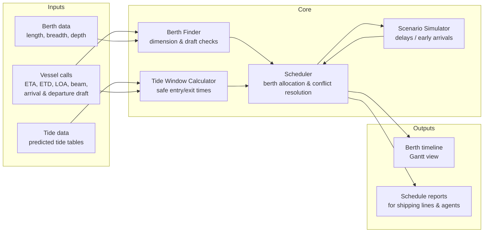
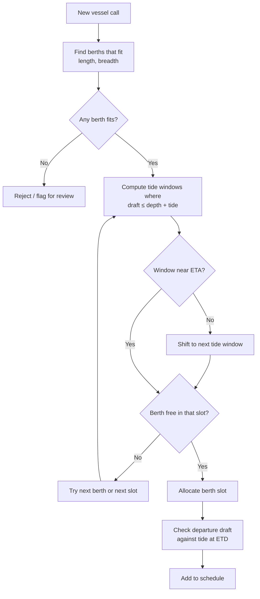
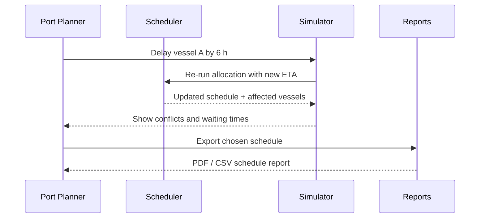
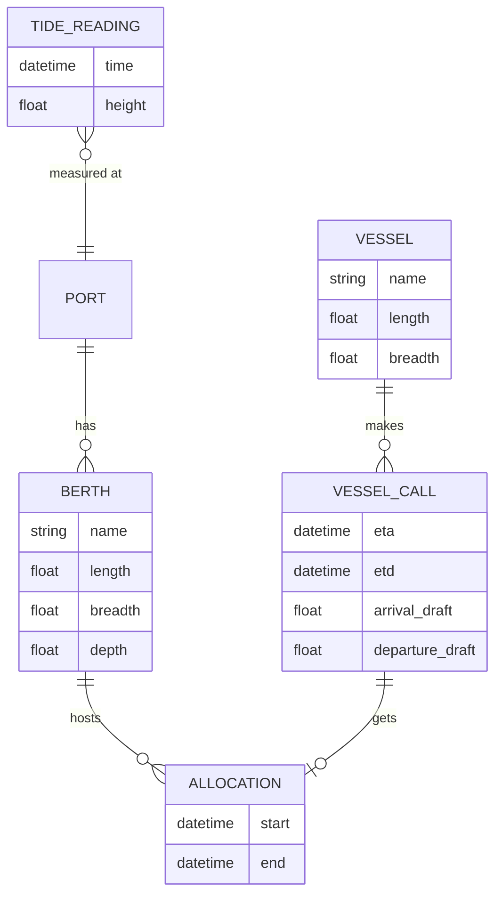
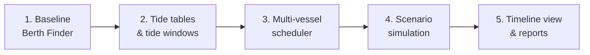

# Ideation

Planned implementation of the port scheduling software. Diagrams use Mermaid and render on GitHub.

## System Overview

## Scheduling Flow

## Scenario Simulation

## Data Model

## Roadmap

